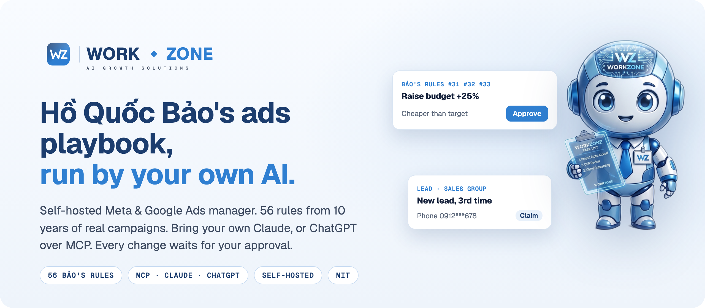
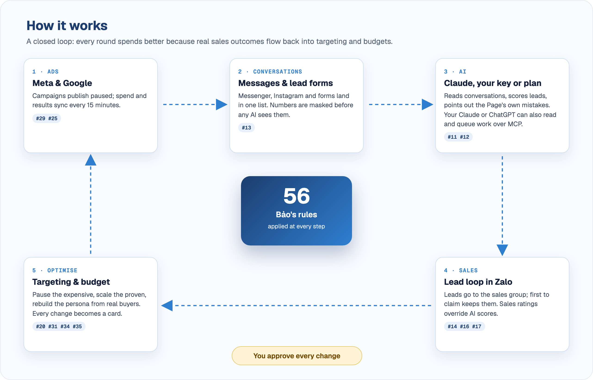

<p align="center">
  
</p>


<p align="center">
  <a href="LICENSE"></a>
  <a href="https://github.com/workzone-vn/workzone-ai-ads/actions/workflows/ci.yml"></a>
  <a href="https://github.com/workzone-vn/workzone-ai-ads/releases"></a>
</p>

<p align="center">
  <a href="#install">Install</a> · <a href="RULES.md">Bảo's rules</a> · <a href="docs/">Docs</a> · <a href="CONTRIBUTING.md">Contributing</a> · <a href="README.vi.md">Tiếng Việt</a>
</p>

<p align="center">
  
</p>

## Why this exists


**Hồ Quốc Bảo** has run ads for 10 years, built an ads agency, and trained more than 3,000 students and 500 businesses in AI, digital marketing and content. He is Head of Digital Full Stack at Workzone and runs client campaigns with this tool every day.

This repository is that tool, given to the community for free: install it on your own machine or server, connect your own AI, and it manages your ads the way Bảo does, with every change waiting for your approval.

<br clear="left">

<p align="center"></p>

The point is not "AI writes ads". It is a closed loop: ads bring conversations → AI reads them → sales rate the leads → those ratings flow back into targeting and optimization, so the next round spends better.

## Bảo's rules

56 numbered rules sit where they run: in the optimizer, the targeting checks, the lead loop, the reports and the AI prompts. Every suggestion in the approval queue shows the rule it follows, and [RULES.md](RULES.md) lists all 56 with the reason behind each and where it lives in the code. 41 are enforced in code, 10 are instructions to the AI, 5 are partly enforced; RULES.md says which.

<p align="center"></p>

## What it does

- **Overview per client**: spend, results, cost per result vs. target, account health score, pending recommendations, hot leads still waiting for a reply.
- **Approval queue**: every change (pause / resume / budget) reaches the Meta API only after a person clicks **Approve**. Limits are checked again at approval time. Three automation modes per client: suggest only, dry run, or auto (pause and budget increases only, with caps and undo).
- **Optimization rules from real campaigns**: e.g. raise budget only when an ad set has spent 90% of its daily budget before 18:00; pause only at 90% confidence, scale at 80%; detect creative fatigue (CTR down while CPM is stable) vs. auction pressure; pause a cheap ad when its good-lead rate is below 60% of the other ads.
- **Message analysis (Messenger / Instagram)**: labels each conversation (intent, buying stage, lead score, needs reply), drafts a suggested reply, and points out the Page's own service mistakes (slow replies, never asking for a phone number…). Only conversations idle for 3 hours are analysed.
- **Audience & targeting**: 2-4 personas with evidence, a bias note against "the targeting that brought these people", expansion directions never tried before, and a ranked list of real Meta interests (AI only names interests; the system looks up the real IDs and checks each one on Meta).
- **Campaign builder**: AI proposes 2-3 directions with a success threshold measurable after 1-2 days, then drafts an Ads-Manager-style campaign (H1 "right need" / H2+ "adjacent situation" ad sets, ABO, ~2.5× target CPR per ad set). Campaigns are always created **paused**.
- **Lead loop**: new leads are posted to the sales team's Zalo / Telegram group with the phone number masked; a salesperson claims the lead from a link, gets reminded after 30 minutes, and rates contact / quality / result. Sales ratings override AI scores.
- **Reports for the business owner**: scheduled daily / weekly reports with the real cost per qualified lead, written from the numbers (no AI-invented figures).
- **Re-engagement**: Messenger follow-ups inside Meta's 24-hour window (sent within 23 hours), never while the customer is waiting for a human reply.
- **Optimization loop view**: a live diagram of the 20 building blocks and the 4-point loop (audience → targeting & content → run & optimize → real customers), showing where data is flowing or stuck.
- **Bring your own AI (MCP)**: an MCP endpoint lets a user's own Claude / ChatGPT read client data and queue work. MCP tools never change anything on Meta or Google directly.
- **Integrations**: Meta Marketing API, Google Ads (read + guarded edits, VND accounts only for now), KiotViet (in-store sales lift), HighLevel, Google Sheets.

<p align="center"></p>

## Install

Self-hosted only: there is no hosted version. Run it on your computer or on your own server; your data stays with you. You need [Docker](https://docs.docker.com/get-docker/) and git.

```bash
git clone https://github.com/workzone-vn/workzone-ai-ads.git
cd workzone-ai-ads
./scripts/install.sh
```

The script creates `.env` with random secrets, asks for your company name and a port, builds and starts everything (database, web app, background worker, hourly scheduler), and prints the address. Open it and create your admin account. Update later with `git pull && ./scripts/install.sh`.

| Guide | |
|---|---|
| [docs/install.md](docs/install.md) | Requirements, install, updates, backups, uninstall, running without Docker, Windows |
| [docs/server.md](docs/server.md) | Domain and HTTPS, `PUBLIC_URL`, firewall, running 24/7 |
| [docs/meta.md](docs/meta.md) | Meta app, System User token and permissions, message webhook |
| [docs/google.md](docs/google.md) | Google Ads manager account, developer token (Basic Access), OAuth client |
| [docs/ai.md](docs/ai.md) | Built-in Claude (optional: API key or your own Claude subscription), or your own Claude / ChatGPT via MCP |

## Safety model

- AI never executes changes on its own; changes wait for approval (or the client's explicit automation mode, which only pauses and raises budgets within caps).
- Recommendations with unknown IDs or budget moves beyond the client's limits become "manual" items.
- Limits are re-checked at approval time; new campaigns are always created paused.
- Meta / Google tokens are encrypted (AES-256-GCM). Names, phone numbers, emails and account numbers are masked before conversations are sent to an AI.
- Every action is logged.

## Project layout

```
src/lib/meta/         Meta connector (graph.ts = real API, mock.ts = sample data)
src/lib/ai/           Prompts, output schemas, context building, AI tasks
src/lib/mcp/          MCP server and tools (bring-your-own-AI)
src/lib/workflow.ts   20-block status model behind the optimization loop view
src/lib/recommendations.ts   Safety limits + executing approved changes
src/lib/sync.ts       Meta → database sync
src/lib/brand.ts      App / operator name and site (from .env)
src/app/              Next.js App Router UI and server actions
prisma/               Schema, migrations, seed data
scripts/              install.sh, worker, hourly scheduler (daily.ts), admin scripts, backups
docs/                 Install, server, Meta, Google Ads and AI guides
Dockerfile, docker-compose.yml   Self-hosted install (app, worker, scheduler, Postgres, optional Caddy)
```

## Operating a public installation

The privacy policy (`src/app/privacy`) and data deletion page are templates. Set `NEXT_PUBLIC_OPERATOR_NAME` / `NEXT_PUBLIC_OPERATOR_SITE` and review the text before going live; you are responsible for it.

## Roadmap and changes

See [ROADMAP.md](ROADMAP.md) for what comes next and [CHANGELOG.md](CHANGELOG.md) for what changed in each release.

## Contributing

Contributions of any kind are welcome, in any language: bug reports, optimization rules from your own campaigns, industry-specific pitfalls, interest sets that worked, new integrations, translations. See [CONTRIBUTING.md](CONTRIBUTING.md).

## Credits

- Optimization playbook (the 56 rules) and original application: **Hồ Quốc Bảo**.
- Published and maintained by **Workzone**.

## License

[MIT](LICENSE): use, modify and redistribute freely, including commercially; keep the copyright notice. This covers the code and the optimization rules in it.

The Workzone name and logo (`public/brand/`, `src/app/icon.svg`) are trademarks of Workzone, and the portrait `public/brand/bao.jpg` belongs to Hồ Quốc Bảo; neither is covered by the MIT license. If you redistribute a modified version, use your own name and logo (set `NEXT_PUBLIC_APP_NAME`, replace the files in `public/brand/`).
