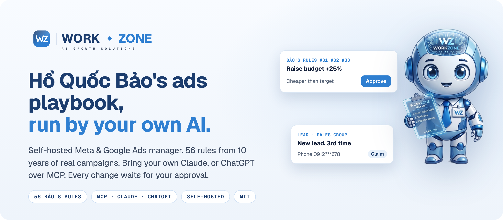
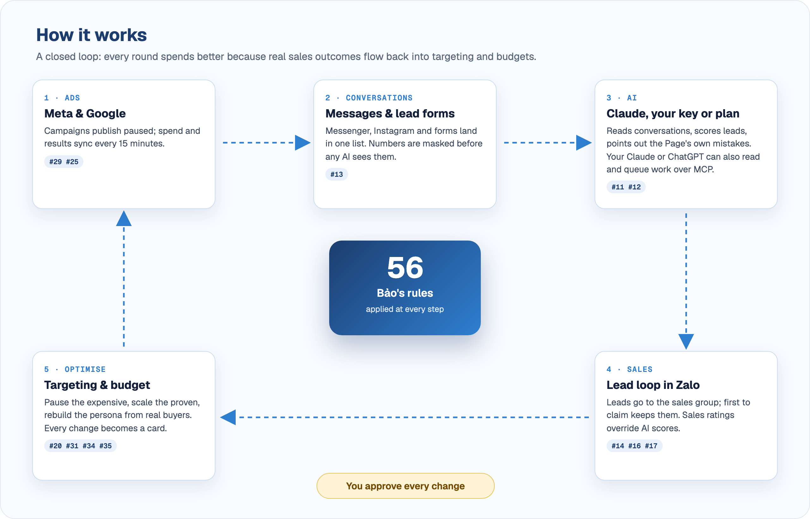

<p align="center">
  
</p>


<p align="center">
  <a href="#cài-đặt">Cài đặt</a> · <a href="RULES.md">Luật Bảo</a> · <a href="docs/">Tài liệu</a> · <a href="CONTRIBUTING.md">Đóng góp</a> · <a href="README.md">English</a>
</p>

<p align="center">
  
</p>

## Vì sao có repo này


**Hồ Quốc Bảo** đã chạy quảng cáo 10 năm, từng lập công ty ads, đào tạo hơn 3.000 học viên và 500 doanh nghiệp về AI, Digital Marketing và Content. Anh là Head of Digital Full Stack tại Workzone và dùng chính công cụ này chạy cho khách mỗi ngày.

Repo này là công cụ đó, chia sẻ miễn phí cho cộng đồng: cài trên máy hoặc máy chủ của bạn, nối AI của bạn, và nó quản lý quảng cáo theo cách anh Bảo làm. Mọi thay đổi đụng tới tiền đều chờ bạn duyệt.

<br clear="left">

<p align="center"></p>

Điểm chính không phải "AI viết quảng cáo", mà là một vòng khép kín: quảng cáo kéo khách nhắn tin → AI đọc hội thoại → sale chấm khách → điểm của sale quay lại chỉnh targeting và ngân sách, vòng sau tiêu tiền tốt hơn.

## Luật Bảo

56 luật được đánh số, nằm đúng chỗ chúng chạy: bộ tối ưu ngân sách, phần kiểm targeting, vòng báo khách cho sale, báo cáo và lời dặn AI. Mỗi đề xuất trong hàng chờ duyệt ghi rõ nó đi theo luật nào. [RULES.md](RULES.md) liệt kê đủ 56 luật, lý do và vị trí trong code; trong app xem ở mục **Luật Bảo**. 41 luật hệ thống tự áp, 10 luật là lời dặn AI, 5 luật áp một phần.

## Làm được gì

- **Tổng quan từng khách**: chi tiêu, kết quả, chi phí mỗi kết quả so với mục tiêu, điểm sức khỏe tài khoản, đề xuất chờ duyệt, khách nóng chưa được trả lời.
- **Hàng chờ duyệt**: mọi thay đổi (tắt, bật, ngân sách) chỉ tới Meta sau khi người bấm **Duyệt**. Ba chế độ tự động cho từng khách: chỉ đề xuất, chạy thử, hoặc tự làm (chỉ tắt và tăng ngân sách, có trần và hoàn tác).
- **Đọc tin nhắn Messenger / Instagram**: gắn nhãn ý định, giai đoạn mua, điểm khách, gợi ý câu trả lời, chỉ ra lỗi chăm sóc của chính Page.
- **Chân dung và targeting**: chân dung có dẫn chứng, hướng mở rộng chưa từng chạy, sở thích thật trên Meta (AI chỉ gọi tên, hệ thống tự tra ID).
- **Dựng chiến dịch**: AI đề xuất 2-3 hướng, dựng chiến dịch kiểu Ads Manager, luôn đăng ở trạng thái **tạm dừng**.
- **Vòng báo khách**: báo lead vào nhóm Zalo / Telegram của sale với số bị che, sale bấm nhận, nhắc sau 30 phút, sale chấm khách.
- **Báo cáo cho chủ shop**: chi phí mỗi khách thật, nhận xét do máy viết từ số liệu, không để AI bịa số.
- **Chăm sóc lại**: nhắn lại trong 23 giờ, không chen khi khách đang chờ người trả lời.
- **AI của bạn (MCP)**: Claude / ChatGPT của bạn đọc dữ liệu khách và xếp việc; công cụ MCP không bao giờ tự sửa trên Meta hay Google.
- **Kết nối**: Meta Marketing API, Google Ads, KiotViet, HighLevel, Google Sheets.
- **Giao diện tiếng Việt và tiếng Anh**, mặc định tiếng Việt.

## Cài đặt

Chỉ có bản tự cài, không có bản chạy sẵn. Chạy trên máy tính hoặc máy chủ của bạn, dữ liệu nằm ở chỗ bạn. Cần [Docker](https://docs.docker.com/get-docker/) và git.

```bash
git clone https://github.com/workzone-vn/workzone-ai-ads.git
cd workzone-ai-ads
./scripts/install.sh
```

Script tự tạo `.env` với khoá ngẫu nhiên, hỏi tên công ty và cổng, dựng và chạy toàn bộ (database, web, worker chạy nền, lịch chạy hằng giờ), rồi in địa chỉ. Mở địa chỉ đó và tạo tài khoản quản trị. Cập nhật sau này bằng `git pull && ./scripts/install.sh`.

Tài liệu chi tiết (tiếng Anh, ngắn, thẳng vào việc): [cài đặt](docs/install.md) · [máy chủ và HTTPS](docs/server.md) · [nối Meta](docs/meta.md) · [nối Google Ads](docs/google.md) · [nối AI](docs/ai.md).

## Đóng góp

Mọi đóng góp đều quý, viết bằng tiếng Việt cũng được: báo lỗi, luật tối ưu từ chiến dịch của bạn, bẫy theo ngành, bộ sở thích đã chạy tốt, kết nối mới, bản dịch. Xem [CONTRIBUTING.md](CONTRIBUTING.md).

## Ghi công và giấy phép

- Bộ luật (56 Luật Bảo) và ứng dụng gốc: **Hồ Quốc Bảo**.
- Phát hành và bảo trì: **Workzone**.

Giấy phép [MIT](LICENSE): dùng, sửa, phân phối lại thoải mái, kể cả thương mại; giữ dòng bản quyền. Tên và logo Workzone, cùng ảnh chân dung anh Bảo, không thuộc giấy phép MIT.
